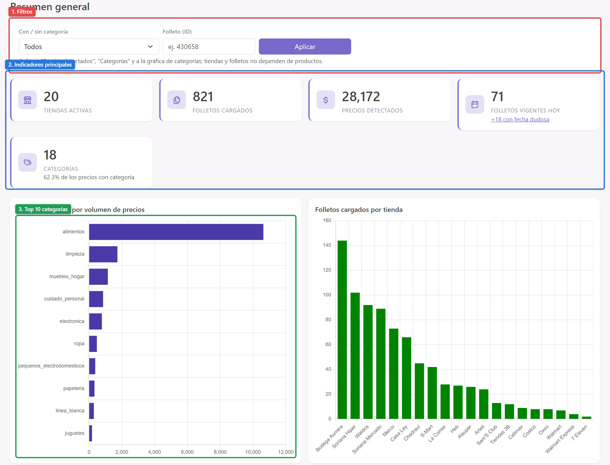
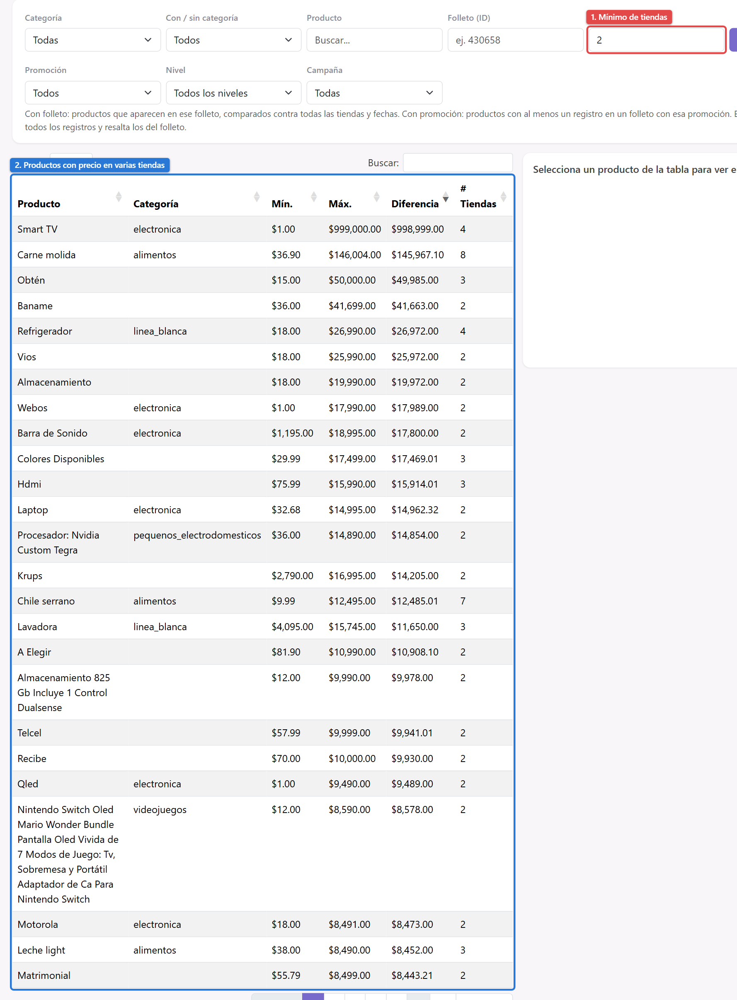
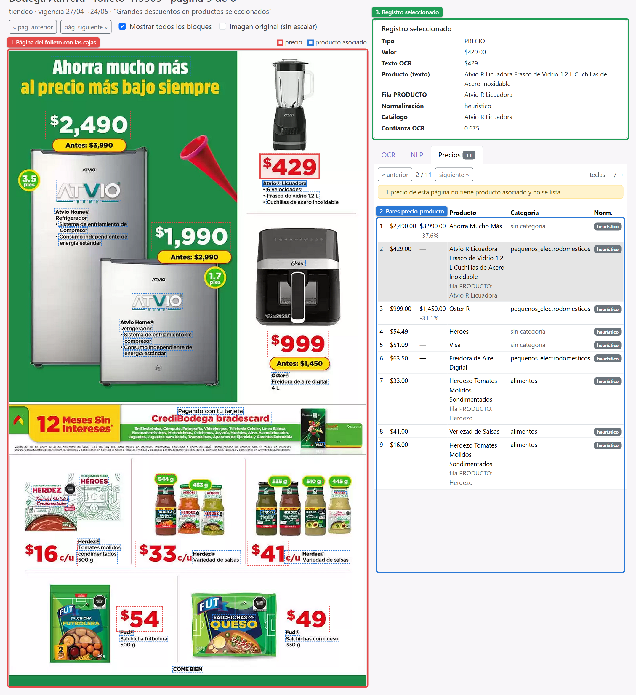

# Uso del dashboard

El dashboard es la aplicación web de Django donde se consultan los precios extraídos de los folletos. Se levanta desde la raíz del repo con `venv/Scripts/python.exe manage.py runserver` y se abre en `http://127.0.0.1:8000`. Necesita PostgreSQL arriba y el archivo `.env` con `DATABASE_URL`.

> Prueba piloto de la skill documentar-proyecto: este capítulo cubre tres páginas; el resto se completa en la siguiente iteración.

## Resumen

La página de inicio da una vista general de lo que hay en la base de datos.

1. **Filtros.** "Con / sin categoría" y "Folleto (ID)" afectan a "Precios detectados", "Categorías" y a la gráfica de categorías. Las tiendas y los folletos no dependen de los productos, así que no cambian.
2. **Indicadores principales.** Tiendas activas, folletos cargados, precios detectados (los registros que muestra el dashboard), folletos vigentes hoy (con el aviso de los que tienen fecha dudosa) y número de categorías con el porcentaje de precios que tienen categoría.
3. **Top 10 categorías.** Cuántos precios hay de cada categoría. A la derecha, los folletos cargados por tienda.

## Comparativa

Lista los productos que aparecen con precio en más de una tienda, con su precio mínimo, máximo y la diferencia.

1. **Mínimo de tiendas.** Cuántas tiendas distintas debe tener un producto para aparecer.
2. **Tabla de productos.** Se ordena por cualquier columna; al hacer clic en un producto, la gráfica de la derecha muestra su precio por tienda.

Esta página todavía agrupa por el texto exacto del producto, así que aparecen grupos que no comparan lo mismo (por ejemplo, "Smart TV" con precios de $1 a $999,000). La versión nueva, por cadena y con una clave de agrupación más flexible, ya está en la base de datos (`v_comparativa_precios_v2`) y falta conectarla a esta página (ver el manual técnico del dashboard).

## Visor de origen

Desde cualquier registro se puede llegar a la página del folleto de donde salió, para comprobar si el dato es correcto.

1. **Página del folleto.** La imagen con las cajas que leyó el OCR. La caja roja es el precio seleccionado y la azul, el producto asociado. "Mostrar todos los bloques" dibuja todas las cajas.
2. **Pares precio-producto.** La pestaña "Precios" lista todos los precios de la página con su producto, precio anterior, categoría y si el nombre viene del catálogo o del texto del folleto. Se recorren con los botones o con las flechas ← / → del teclado.
3. **Registro seleccionado.** El detalle del precio: el texto que leyó el OCR, el nombre del producto, la fila PRODUCTO de donde salió, el método de normalización y la confianza del OCR.
